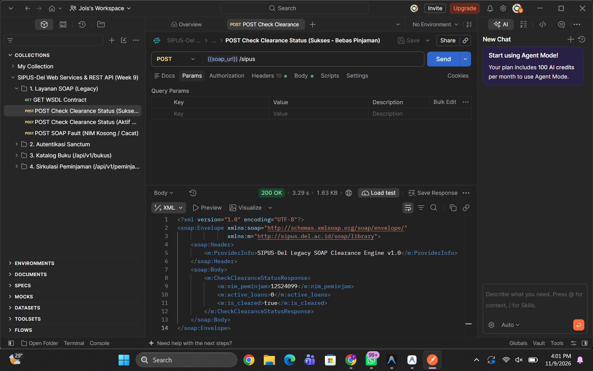
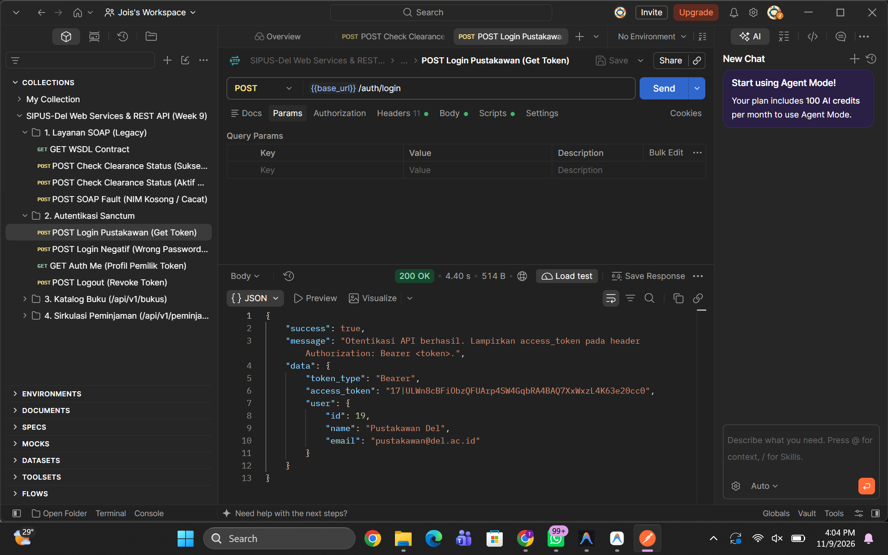
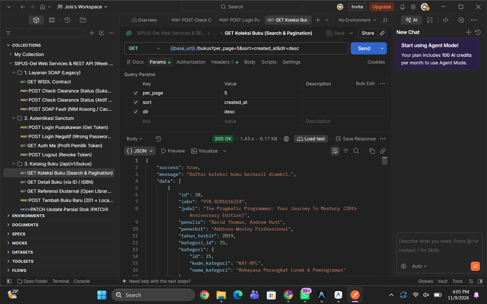
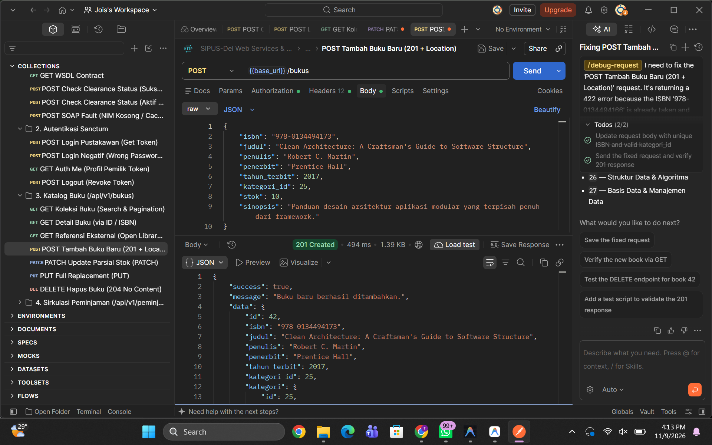
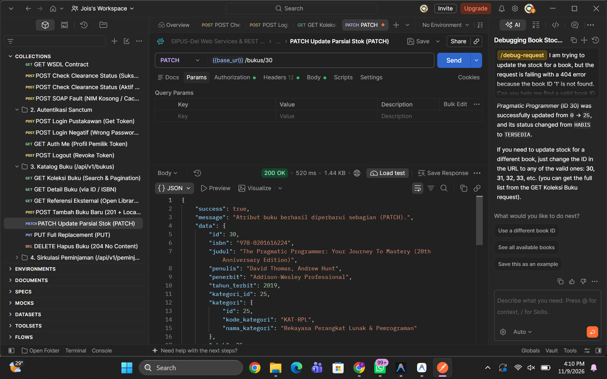
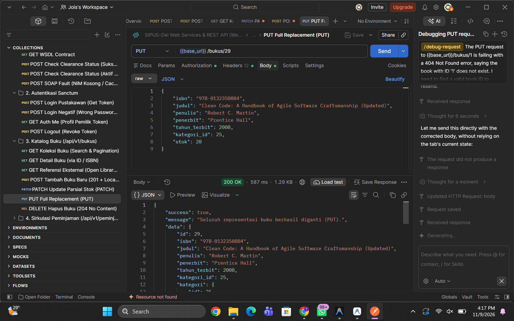
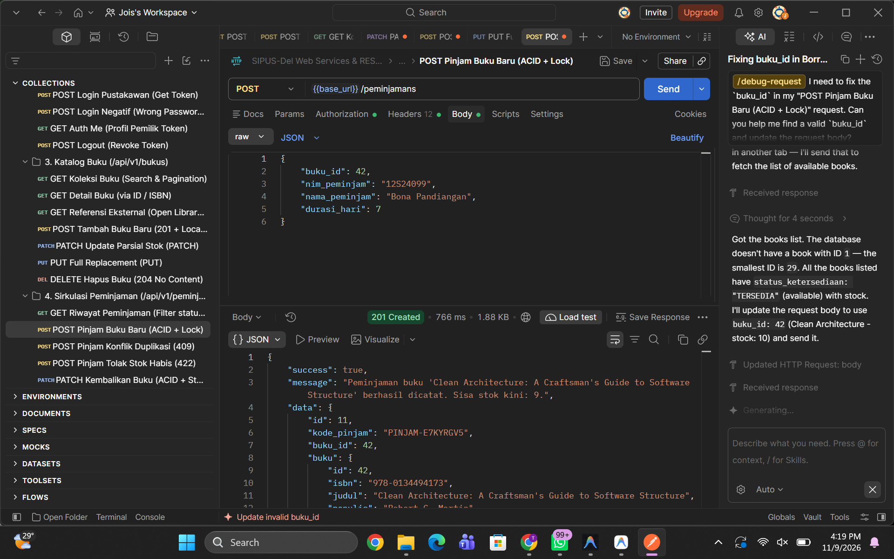
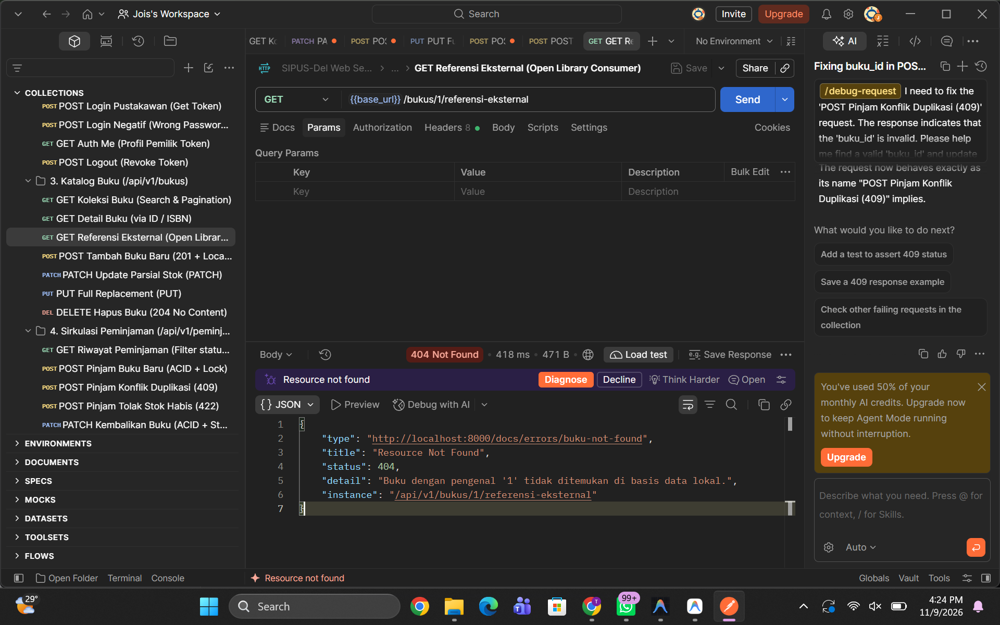
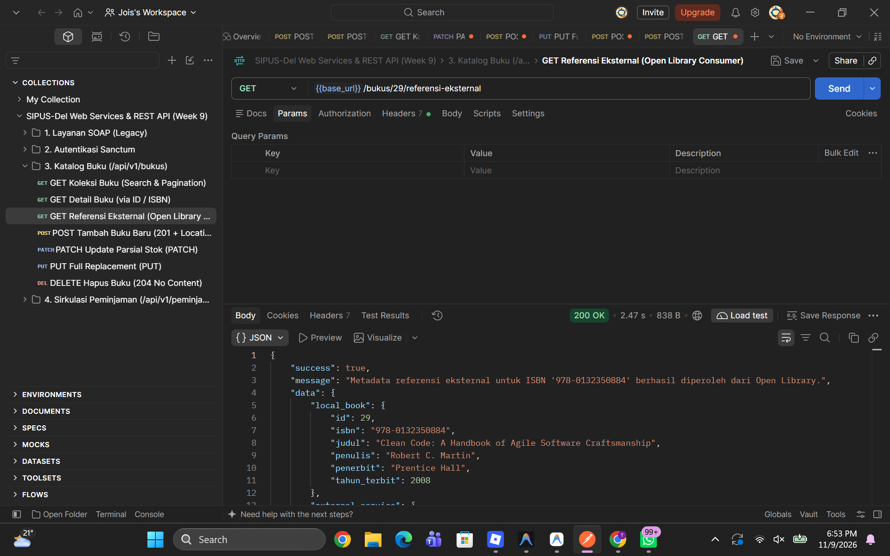

# Sistem Informasi Perpustakaan Kampus Del (SIPUS-Del) — Tahap 3
**Tugas Mandiri Praktikum Pemrograman & Pengujian Web (12S3101) — Minggu 09**  
**Program Studi Sarjana Sistem Informasi • Fakultas Informatika dan Teknik Elektro • Institut Teknologi Del**

---

## 👤 Identitas Mahasiswa

| Atribut | Informasi |
| :--- | :--- |
| **Nama Lengkap** | Joice Napitupulu |
| **NIM** | 12S24020 |
| **Kelas** | 12S1 / Sarjana Sistem Informasi |
| **Program Studi** | Sarjana Sistem Informasi |
| **Mata Kuliah** | Pemrograman dan Pengujian Aplikasi Web (12S3101) |
| **Dosen Pengampu** | Chandro Pardede, S.Kom., M.Sc. |
| **Branch Repositori** | `week9-rest-api` |

---

## 🏛️ 1. Analisis Kebutuhan & Kelayakan Web Services (Feasibility Analysis)

### 1.1 Latar Belakang & Transformasi Arsitektur
Pada pengembangan tahap sebelumnya (Minggu 1 s.d. Minggu 6), SIPUS-Del dibangun sebagai aplikasi web monolitik berorientasi manusia (*Human-to-Machine*). Pengguna mengakses sistem melalui peramban web (browser), mengirimkan form HTTP dengan proteksi CSRF token, dan server mengembalikan dokumen presentasi HTML + CSS (Blade) berukuran puluhan hingga ratusan kilobyte.

Memasuki tahap 3 (Minggu 9), perpustakaan IT Del memerlukan interoperabilitas lintas sistem (*Machine-to-Machine* / M2M) untuk mendukung integrasi dengan sistem legacy kampus, peluncuran Kiosk Mandiri, serta aplikasi mobile mahasiswa.

```
+-----------------------------------------------------------------------------------+
|               TRANSFORMASI ARSITEKTUR SIPUS-DEL: MONOLITIK KE WEB SERVICES         |
+-----------------------------------------------------------------------------------+
|                                                                                   |
| A. WEB MONOLITIK (Human-to-Machine):                                              |
|    [Browser Pengguna] ──(GET /buku + Session Cookie)──► [Laravel Web Routes]      |
|    [Browser Pengguna] ◄──(HTML Blade + CSS ~150 KB)──── [BukuController (View)]   |
|                                                                                   |
| B. WEB SERVICES DISTRIBUSI (Machine-to-Machine):                                   |
|    1. Legacy SOAP Service:                                                        |
|       [Sistem Yudisium Legacy] ──(SOAP XML Envelope)──► [LibrarySoapController]   |
|       [Sistem Yudisium Legacy] ◄──(<soap:Envelope>)──── [Clearance Engine]        |
|                                                                                   |
|    2. REST API Provider (API v1):                                                 |
|       [App Mobile Android] ┐                                                      |
|       [Kiosk Mandiri Del ] ├──(JSON + Bearer Token)───► [Laravel API Provider v1] |
|       [Frontend SPA React] ┘◄──(RFC 7807 / HATEOAS)──── [Resource & Controllers]  |
|                                                                                   |
|    3. REST API Consumer:                                                          |
|       [SIPUS-Del Backend] ──(Http::get + ISBN)────────► [Open Library REST API]   |
|       [SIPUS-Del Backend] ◄──(Metadata JSON)─────────── [Pengayaan Data Buku]     |
+-----------------------------------------------------------------------------------+
```

---

### 1.2 Matriks Peran SIPUS-Del: Service Provider vs Service Consumer

| Peran Arsitektur | Komponen / Endpoint | Target Konsumen / Penyedia | Protokol & Format | Alasan & Tanggung Jawab Bisnis |
| :--- | :--- | :--- | :--- | :--- |
| **Service Provider (SOAP)** | `POST /soap/sipus`<br>`GET /soap/sipus.wsdl` | Sistem Administrasi Bebas Pustaka Yudisium (Sistem Kampus *Legacy*) | SOAP 1.1 over HTTP (XML Envelope & WSDL) | Menyediakan layanan pengecekan tanggungan buku mahasiswa secara otomatis bagi sistem yudisium lama tanpa perlu merombak arsitektur sistem enterprise yang sudah terpasang. |
| **Service Provider (REST API)** | `POST /api/v1/auth/login`<br>`/api/v1/bukus` (CRUD)<br>`/api/v1/peminjamans` (ACID) | Aplikasi Mobile Mahasiswa, Aplikasi Kiosk Mandiri Perpustakaan, Dashboard Frontend SPA | RESTful Web API (JSON, Bearer Token Sanctum, RFC 7807) | Mengekspos katalog buku dan sirkulasi transaksi peminjaman/pengembalian buku yang ringan, cepat, *stateless*, dan aman terhadap *race condition*. |
| **Service Consumer (REST)** | `GET /api/v1/bukus/{id}/referensi-eksternal` | Open Library Books REST API (`openlibrary.org`) | REST API Client via `Illuminate\Support\Facades\Http` | Mengonsumsi metadata bibliografi eksternal secara dinamis berdasarkan ISBN (jumlah halaman, penerbit resmi, sampul edisi cetak) untuk memperkaya informasi katalog lokal. |

---

### 1.3 Alasan Teknis Pemilihan REST untuk Aplikasi Mobile/Kiosk dibanding SOAP

Meskipun protokol SOAP tetap dipertahankan untuk integrasi sistem yudisium *legacy*, arsitektur **RESTful Web API** dipilih secara mutlak sebagai fondasi layanan Mobile Mahasiswa dan Kiosk Mandiri Perpustakaan berdasarkan pertimbangan rekayasa perangkat lunak berikut:

1. **Efisiensi Ukuran Payload & Penghematan Bandwidth (5–8x Lebih Ringkas):**
   - SOAP mewajibkan pembungkusan pesan di dalam amplop XML yang sangat besar (*verbose*) memuat tag `<soap:Envelope>`, `<soap:Header>`, `<soap:Body>`, serta XML Namespace.
   - REST menggunakan representasi murni JSON (`application/json`) yang ringkas, sehingga menghemat kuota transmisi pada koneksi nirkabel/seluler perangkat mobile.
2. **Kecepatan Parsing & Dukungan Native pada Platform Klien:**
   - JSON didukung secara *native* pada mesin runtime modern (JavaScript/TypeScript, Kotlin/Android, Dart/Flutter, dan Swift/iOS) tanpa membutuhkan pustaka XML parser pihak ketiga.
   - Parsing XML SOAP memakan alokasi memori dan siklus CPU yang jauh lebih tinggi di perangkat mobile.
3. **Pemanfaatan Semantik HTTP Murni (HTTP Verbs & Status Codes):**
   - SOAP memperlakukan HTTP hanya sebagai pipa saluran (*tunneling*) dan selalu menggunakan metode `POST`, bahkan untuk membaca data sekalipun.
   - REST memanfaatkan semantik HTTP alami secara presisi: `GET` (aman & idempoten untuk membaca), `POST` (membuat data baru), `PUT` (*full replacement*), `PATCH` (*partial update*), dan `DELETE` (menghapus), disertai status code standar (`200`, `201`, `204`, `401`, `404`, `409`, `422`).
4. **Skalabilitas & Sifat Stateless Berbasis Bearer Token (Zero Server Session):**
   - Pada aplikasi monolitik berbasis web browser, server menyimpan sesi di memori/file lokal (`session_id`). Jika sistem dipasang di belakang *Load Balancer* dengan banyak node server, sesi pengguna dapat terputus.
   - REST API bersifat sepenuhnya *Stateless*: setiap request membawa kredensial mandiri berupa *Sanctum Bearer Token*. Node server mana pun di klaster cloud dapat melayani request tanpa sinkronisasi memori sesi.
5. **Kemudahan Integrasi Kontrak OpenAPI 3.0 & Dokumentasi Interaktif:**
   - Kontrak WSDL SOAP kaku dan rumit dianalisis secara manual. REST modern didokumentasikan menggunakan spesifikasi **OpenAPI 3.0 (Swagger)** yang mudah diinspeksi oleh manusia dan dapat diuji langsung melalui Postman.

---

## 📋 2. Tabel Katalog Endpoint Web Services (SOAP & REST API v1)

| No | Metode | Endpoint (URI) | Proteksi Autentikasi | Deskripsi Operasi & Perilaku Bisnis | Kode Status Respons |
| :-: | :--- | :--- | :--- | :--- | :--- |
| **A** | **LAYANAN SOAP (LEGACY INTEGRATION)** | | | | |
| 1 | `GET` | `/soap/sipus.wsdl` | Publik | Menyajikan dokumen kontrak formal WSDL XML untuk operasi `CheckClearanceStatus`. | `200 OK` (text/xml) |
| 2 | `POST` | `/soap/sipus` | Publik (Bebas CSRF) | Menerima `<soap:Envelope>` berisi `<nim_peminjam>`, menghitung pinjaman aktif, mengembalikan `<active_loans>` dan `<is_cleared>`. Mengembalikan `<soap:Fault>` jika tag kosong / XML malformed. | `200 OK`, `500 Internal Server Error` (`soap:Fault`) |
| **B** | **AUTENTIKASI STATELESS (SANCTUM BEARER TOKEN)** | | | | |
| 3 | `POST` | `/api/v1/auth/login` | Publik | Memverifikasi kredensial email & password pustakawan, menerbitkan token `plainTextToken`. | `200 OK`, `401 Unauthorized`, `422 Unprocessable` |
| 4 | `GET` | `/api/v1/auth/me` | `auth:sanctum` | Mengambil profil pustakawan pemilik token yang sedang aktif. | `200 OK`, `401 Unauthorized` |
| 5 | `POST` | `/api/v1/auth/logout` | `auth:sanctum` | Mencabut (*revoke*) token aktif dari basis data dan mengakhiri sesi API. | `200 OK`, `401 Unauthorized` |
| **C** | **REST PROVIDER: KATALOG BUKU (`/api/v1/bukus`)** | | | | |
| 6 | `GET` | `/api/v1/bukus` | Publik | Daftar buku terpaginasi bebas N+1 problem (`with('kategori')`, `withCount('peminjamans')`). Mendukung `?search=`, `?kategori_id=`, `?tersedia=1`, `?sort=`, `?dir=`, `?per_page=`. | `200 OK` |
| 7 | `GET` | `/api/v1/bukus/{id}` | Publik | Detail lengkap buku berdasarkan ID atau ISBN beserta objek kategori dan relasi riwayat peminjaman. | `200 OK`, `404 Not Found` (RFC 7807) |
| 8 | `GET` | `/api/v1/bukus/{id}/referensi-eksternal` | Publik | **REST Consumer**: Mengambil metadata eksternal buku dari Open Library API berdasarkan ISBN via `Http` facade. | `200 OK`, `404 Not Found`, `502 Bad Gateway` |
| 9 | `POST` | `/api/v1/bukus` | `auth:sanctum` | Menambah data buku baru dengan validasi ketat (ISBN unik, stok >= 0, kategori valid). | `201 Created` (+ Header `Location`), `401`, `422` |
| 10 | `PUT` | `/api/v1/bukus/{id}` | `auth:sanctum` | **Full Replacement**: Mengganti seluruh representasi buku. Seluruh atribut wajib dikirim; field nullable yang diabaikan direset menjadi null. | `200 OK`, `401`, `404`, `422` |
| 11 | `PATCH` | `/api/v1/bukus/{id}` | `auth:sanctum` | **Partial Update**: Memperbarui sebagian atribut (misal: hanya stok). Menolak body kosong dengan `400 Bad Request`. | `200 OK`, `400 Bad Request`, `401`, `404`, `422` |
| 12 | `DELETE` | `/api/v1/bukus/{id}` | `auth:sanctum` | Menghapus buku. Ditolak jika ada peminjaman berstatus `dipinjam`. | `204 No Content`, `401`, `404`, `409 Conflict` |
| **D** | **REST PROVIDER: TRANSAKSI SIRKULASI ACID (`/api/v1/peminjamans`)** | | | | |
| 13 | `GET` | `/api/v1/peminjamans` | `auth:sanctum` | Menampilkan seluruh riwayat transaksi peminjaman terpaginasi. Mendukung filter `?status=dipinjam|dikembalikan` dan `?nim=...`. | `200 OK`, `401 Unauthorized` |
| 14 | `GET` | `/api/v1/peminjamans/{id}` | `auth:sanctum` | Detail riwayat satu transaksi peminjaman. | `200 OK`, `401`, `404 Not Found` |
| 15 | `POST` | `/api/v1/peminjamans` | `auth:sanctum` | Mencatat transaksi peminjaman baru terbungkus `DB::transaction()` + `lockForUpdate()`. Cek stok (<1 -> 422), cek duplikasi pinjaman aktif (409), kurangi stok (-1) secara atomik. | `201 Created` (+ Header `Location`), `401`, `409`, `422` |
| 16 | `PATCH` | `/api/v1/peminjamans/{id}/kembalikan` | `auth:sanctum` | Mengembalikan buku terbungkus `DB::transaction()` + `lockForUpdate()`. Tolak jika sudah dikembalikan (409), isi `tanggal_kembali`, tambah stok (+1) secara atomik. | `200 OK`, `401`, `404`, `409 Conflict` |

---

## 🛠️ 3. Panduan Instalasi & Pengujian Cepat

### 3.1 Prasyarat Sistem
- PHP `>= 8.2` (ekstensi aktif: `pdo_pgsql` / `pdo_sqlite`, `openssl`, `mbstring`, `xml`, `dom`, `simplexml`, `curl`, `json`)
- Composer `>= 2.6`
- PostgreSQL `>= 14` (atau SQLite untuk pengetesan lokal)
- Postman Desktop Client (atau Thunder Client / cURL)

### 3.2 Langkah Pemasangan Proyek
1. **Clone Repositori & Masuk ke Branch `week9-rest-api`:**
   ```bash
   git clone https://github.com/JoiceNapitupulu/ppw-2026-week5-12S24020.git
   cd ppw-2026-week5-12S24020
   git checkout week9-rest-api
   ```

2. **Pasang Dependensi Composer:**
   ```bash
   composer install
   ```

3. **Konfigurasi Berkas `.env`:**
   Salin berkas template lingkungan:
   ```bash
   cp .env.example .env
   php artisan key:generate
   ```
   Pastikan konfigurasi koneksi basis data di berkas `.env` sudah sesuai:
   ```env
   DB_CONNECTION=pgsql
   DB_HOST=127.0.0.1
   DB_PORT=5432
   DB_DATABASE=sipus_del
   DB_USERNAME=postgres
   DB_PASSWORD=rahasia
   ```

4. **Jalankan Migrasi Basis Data & Seeder Data Uji:**
   ```bash
   php artisan migrate:fresh --seed
   ```
   *Seeder otomatis menyiapkan akun pustakawan, master kategori, katalog buku realistis (termasuk buku dengan stok 0 dan stok 1 untuk uji ACID), serta data peminjaman awal.*

5. **Kredensial Akun Uji Pustakawan (Seed Data):**
   - **Email:** `pustakawan@del.ac.id`
   - **Password:** `password123`

6. **Jalankan Server Lokal Laravel:**
   ```bash
   php artisan serve
   ```
   *Server aktif melayani permintaan HTTP pada alamat `http://localhost:8000`.*

7. **Menjalankan Pengujian Otomatis (Automated Test Suite):**
   ```bash
   php artisan test
   ```
   *Seluruh 30 unit & feature tests (SOAP Test, Core RFC 7807 Test, Auth API Test, Buku API Test, Peminjaman ACID Test, dan External Consumer Test) akan dieksekusi.*

8. **Mengimpor Koleksi Postman:**
   - Buka Postman Desktop -> Klik tombol **Import**.
   - Arahkan ke file: `docs/SIPUS-Del-API-v1.postman_collection.json`.
   - Pastikan variabel koleksi `base_url` bernilai `http://localhost:8000/api/v1` dan `token` diisi setelah menjalankan request Login.

---

## 📸 4. Galeri Bukti Pengujian (Screenshots Pengujian Mandiri)

Bagian ini menyajikan dokumentasi tangkapan layar pengujian fungsionalitas Web Services SOAP dan REST API v1 sesuai dengan 7 skenario wajib pada spesifikasi penugasan:

---

### (a) Bukti Uji SOAP XML & Penanganan `<soap:Fault>`
> **Skenario:** Menguji endpoint `POST /soap/sipus` menggunakan Postman dengan body XML `<CheckClearanceStatusRequest>`. Skenario sukses menunjukkan status mahasiswa bebas peminjaman (`<is_cleared>true</is_cleared>`), dan skenario galat menunjukkan respon status `500` dengan amplop `<soap:Fault>` saat tag `<nim_peminjam>` kosong atau format XML rusak (*malformed*).


*Gambar 4.1: Pengujian SOAP Clearance Status dan respon `<soap:Fault>`.*

---

### (b) Bukti Uji Otentikasi Stateless (Login & Penerbitan Sanctum Bearer Token)
> **Skenario:** Menguji `POST /api/v1/auth/login` dengan kredensial pustakawan (`pustakawan@del.ac.id` / `password123`). Menghasilkan status `200 OK` beserta `access_token` bertipe `Bearer` dan objek identitas pustakawan, serta pengujian negatif `401 Unauthorized` format RFC 7807 saat password salah.


*Gambar 4.2: Penerbitan Sanctum Bearer Token saat login API berhasil.*

---

### (c) Bukti Uji GET Katalog Buku Terpaginasi & Kontrol Hypermedia HATEOAS
> **Skenario:** Menguji `GET /api/v1/bukus?per_page=3&tersedia=1` yang memuat metadata paginasi lengkap (`total_items`, `total_pages`, links). Membuktikan kontrol HATEOAS: buku dengan stok > 0 memiliki link `"pinjam_buku"`, sedangkan buku dengan stok 0 tidak memuat link tersebut.


*Gambar 4.3: Daftar koleksi buku terpaginasi dengan tautan dinamis HATEOAS `_links`.*

---

### (d) Bukti Uji POST Buku Baru (Status 201 Created & Header Location)
> **Skenario:** Menguji penambahan buku baru via `POST /api/v1/bukus` dengan header `Authorization: Bearer <token>`. Menghasilkan status `201 Created` dan pada tab response headers terdapat header `Location: http://localhost:8000/api/v1/bukus/{id}`.


*Gambar 4.4: Penambahan buku baru berhasil dengan status 201 dan header Location.*

---

### (e) Bukti Uji Perbedaan Semantik PUT (Full Replacement) vs PATCH (Partial Update)
> **Skenario:** 
> 1. Menguji `PATCH /api/v1/bukus/{id}` hanya mengirimkan body `{"stok": 25}` -> atribut lain tetap utuh tidak berubah.
> 2. Menguji `PUT /api/v1/bukus/{id}` mengirim seluruh representasi tanpa menyertakan kolom opsional `sinopsis` -> sinopsis direset menjadi `null` di basis data.


*Gambar 4.5.1: Pengujian modifikasi parsial (PATCH) yang hanya memperbarui atribut stok.*


*Gambar 4.5.2: Pengujian penggantian penuh representasi (PUT).*

---

### (f) Bukti Uji Transaksi Sirkulasi ACID (Peminjaman Sukses, Penolakan 422 & 409)
> **Skenario:**
> 1. Peminjaman sukses `POST /api/v1/peminjamans` -> status `201 Created`, stok buku otomatis berkurang secara atomik via `lockForUpdate()`.
> 2. Penolakan stok habis -> status `422 Unprocessable Content` dengan pesan *"Stok buku sedang habis"*.
> 3. Penolakan duplikasi pinjaman aktif oleh mahasiswa yang sama -> status `409 Conflict`.
> 4. Pengembalian buku `PATCH /api/v1/peminjamans/{id}/kembalikan` -> status `200 OK`, stok kembali bertambah (+1).


*Gambar 4.6.1: Transaksi peminjaman buku baru berhasil dengan status 201 Created.*


*Gambar 4.6.2: Penolakan duplikasi pinjaman aktif oleh mahasiswa yang sama (409 Conflict berstandar RFC 7807).*

---

### (g) Bukti Uji Konsumsi REST API Eksternal (Open Library / GitHub API)
> **Skenario:** Menguji konsumsi REST API eksternal via Laravel HTTP Client (`GET /api/v1/bukus/{id}/referensi-eksternal` ke Open Library API dan/atau eksplorasi cURL/Postman GitHub API `PATCH /user`) dengan token disensor demi keamanan.


*Gambar 4.7: Bukti pengujian konsumsi API eksternal dengan penyensoran token rahasia.*

---

## 🔒 5. Catatan Disiplin Keamanan Token & Berkas Sensitif
- Seluruh kredensial rahasia, access token, dan konfigurasi lingkungan disimpan secara ketat di dalam berkas `.env` dan diabaikan oleh Git via `.gitignore`.
- Seluruh Personal Access Token (PAT) eksternal dan Sanctum Bearer Token yang ditampilkan pada dokumentasi pengujian telah disensor sebagian karakternya guna memenuhi standar keamanan perangkat lunak.
